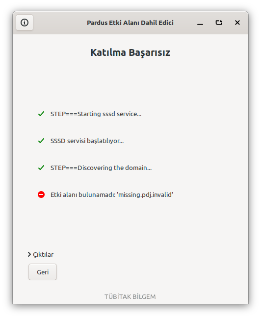
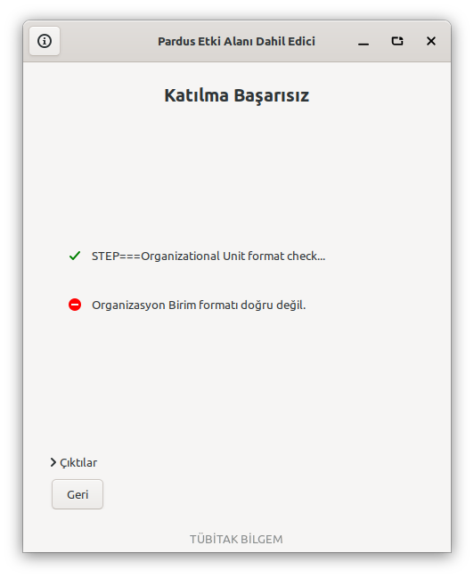

# Geçersiz OU ile katılma: önce/sonra ölçümü

16 Ekim 2026, bağımsız Pardus 25.2 XFCE sanal makinesi.

- Temel kaynak: `2445ba8df92905b7a6d5fecc2a34221f4f53a0f9`.
- Düzeltme: [9ad111a](https://github.com/muhammetali/pardus-lib-domain-joiner/commit/9ad111a7dbea3ca9244e13cb200c5b28320ff54b).
- Resmî kitaplık: `pardus-lib-domain-joiner 0.2.8`; GUI: `pardus-domain-joiner 0.5.5`.
- [Ortam ve yamasız dosya sağlaması](lab-environment.log).
- [Derlenen paket ve kurulu dosya sağlamaları](package-after-validation.log).

## Gerçek sistemde gözlenen fark

OU olarak `computers`, etki alanı olarak kasıtlı biçimde bulunmayan
`missing.pdj.invalid` kullanıldı. Gerçek bir hesap veya etki alanı yok.

Resmî pakette OU denetlenmeden önce servis ayarları ve PAM profili değişiyor.
Sonra keşif başarısız oluyor. Düzeltmede OU hatası bu işlemler başlamadan dönüyor.

| Ölçüm | Resmî 0.2.8 | Düzeltme |
|---|---|---|
| Winbind, geçersiz OU | 4 PAM dosyası ve 4 PAM durum dosyası değişti; SSSD devre dışı, Winbind etkin/çalışır oldu | İzlenen dosyalar ve servis durumları korundu |
| SSSD/realmd, geçersiz OU | Aynı 8 dosya değişti; Winbind devre dışı, SSSD etkin oldu | İzlenen dosyalar ve servis durumları korundu |

SSSD için bir etki alanı yapılandırılmadığından servis etkin olsa da çalışmıyor;
ölçümde `enabled` ve `active` ayrı kaydedildi. Başarılı katılım iddiası yok.

Her yöntem için eski ve yeni koşunun başlangıç durumları **birebir aynı**.
Dosyaların içerik sağlaması, izinleri ve sahipliği; hostname; servislerin
etkin/çalışır durumları karşılaştırıldı. [Makinece okunabilir özet](comparison.json).

- [Winbind önce](before-winbind.json) · [Winbind sonra](after-winbind.json)
- [SSSD önce](before-realmd.json) · [SSSD sonra](after-realmd.json)
- [Önce işlem çıktısı](live-before.log) · [Sonra işlem çıktısı](live-after.log)

## Gerçek arayüz

Kurulu `Main.py` ve gerçek `Actions.py` çalıştırıldı. Düğmeler
[betikle](domain-validation-gui.py) tetiklendi; uygulama metotları veya alt süreçler
taklit edilmedi. Aynı hatalı giriş SSSD yolunda karşılaştırıldı. Görüntüler doğrudan
pencereden alındı. Laboratuvarda GUI root ile açıldı; polkit yetkilendirme
penceresinin davranışı bu deneyin kapsamında değil.

| Önce: servis hazırlığı ve etki alanı hatası | Sonra: doğrudan OU biçim hatası |
|---|---|
|  |  |

[Önce arayüz çıktısı](gui-before/result.json) · [Sonra arayüz çıktısı](gui-after/result.json).

## Regresyon ve paket

[Kaynak dalındaki beş test](https://github.com/muhammetali/pardus-lib-domain-joiner/blob/9ad111a7dbea3ca9244e13cb200c5b28320ff54b/tests/test_join_validation.py)
iki yöntem için geçersiz OU'yu, doğrudan handler çağrılarını, varsayılan dizini,
geçerli OU argümanlarını ve mevcut hata dönüşlerini kapsıyor.

- Yamasız kodda **8 alt senaryo başarısız**, altyapı hatası yok:
  [yerel](tests-before.log), [VM'de kurulu resmî paket](tests-before-vm.log).
- Düzeltmede **5 test metodu geçti**:
  [yerel Python 3.12](tests-after-local.log), [VM'de kurulu paket/Python 3.13](tests-after-vm.log).
- [Debian paket derlemesi](package-build.log) başarılı; Meson aynı testleri
  `dh_auto_test` sırasında çalıştırdı.
- Kurulu yama dosyası kaynakla aynı; `dpkg --audit` ve ilgili paketlerin
  `dpkg -V` kontrolleri temiz.

## Yeniden üretme ve sınırlar

[Gerçek sistem ölçüm betiği](domain-validation-live.py) yalnız adı
`pardus-domain-lab` olan ve `/root/domain-validation-lab` işareti bulunan ayrı
laboratuvarda root olarak çalışır. Önce iki servisi durdurup devre dışı bırakır,
denenecek yöntemin karşıtını etkinleştirir ve PAM başlangıç durumunu kurar.
Ardından gerçek kitaplığın `join()` çağrısından hemen önce/sonra ölçüm alır.

```sh
LANG=C.UTF-8 python3 domain-validation-live.py --backend winbind --output winbind.json
LANG=C.UTF-8 python3 domain-validation-live.py --backend realmd --output realmd.json
```

Betik eski pakette bilerek gerçek servis/PAM değişiklikleri oluşturur; deney
anlık görüntülü, bağımsız VM'de yapıldı. Başlangıç koşulları karşılaştırma
JSON'larında saklıdır. GUI deneyi için Türkçe yerel, açık X11 oturumu ve root
kullanıcısının yapılandırma dizini hazırlandı.

OU söz dizimi kuralı değiştirilmedi. Geçerli OU/default container kontrolleri
birim testlerinde; gerçek AD sunucusuna başarılı katılma/ayrılma, gerçek hesapla
oturum açma ve Pardus 23 bu çalışmada denenmedi. Genel geri alma sistemi ve
silinen bir hedef dosyanın geri getirilmesi bu düzeltmenin kapsamı dışında.
